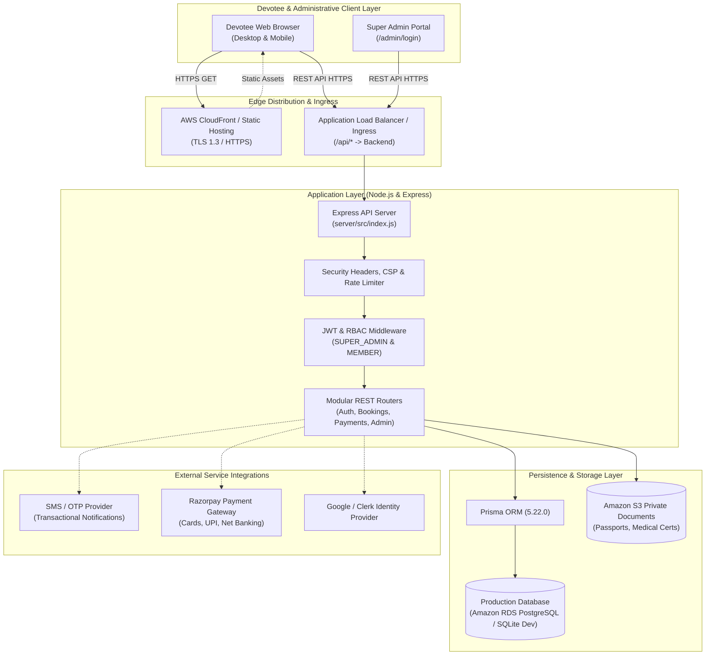

# Shloka Yatra 2027 — System Architecture Document

## 1. System Overview

Shloka Yatra 2027 is an enterprise-grade pilgrimage registration and management portal engineered specifically for the sacred Mount Kailash and Lake Manasarovar Yatra 2027. The system delivers a seamless end-to-end journey for devotees, encompassing spiritual package discovery, member registration, multi-step contractually compliant booking, document submission, and payment handling, backed by a unified **Super Admin Command Center**.

---

## 2. Frontend Architecture

* **Framework & Runtime:** React 18.3.1 running inside standard ECMAScript modules (ESM).
* **Build System & Bundler:** Vite 6.0.7 with `@vitejs/plugin-react`.
* **Client-Side Routing:** React Router DOM 6.28.1 implementing declarative routes, nested layout routes, and protected administrative route guards.
* **Component Architecture:**
  * `client/src/components/`: Reusable interface components (Navbar, Footer, Modals, Layouts, LanguageToggle, RiskDeclarationModal, StaticHostingBanner).
  * `client/src/pages/`: Public pages (Home, About, Packages, Itineraries, Departures, Contact, Preparation, Legal Policies).
  * `client/src/pages/admin/`: Super Admin Portal pages (Dashboard, Bookings, Customers, Payments, Departures, Pricing, Documents, Refunds, Enquiries, WhatsApp, Audit Logs).
* **State Management:** React Context API (`LanguageContext` for dual-language English/Hindi UI state) and local reactive component hooks (`useState`, `useEffect`, `useMemo`).
* **Form Validation:** React Hook Form (`useForm`, `useFieldArray`) integrated with **Zod** schema validation (`@hookform/resolvers/zod`).
* **API Service Layer:** `client/src/services/api.js` providing centralized HTTP abstraction with JWT injection, network retry diagnostics, and static hosting detection.
* **Styling & Design System:** Tailwind CSS 3.4.19 with custom theme extensions reflecting sacred Vedic luxury palette (`#101D35` Midnight Navy, `#D9A441` Sacred Gold, `#F7F9FC` Cloud White).

---

## 3. Backend Architecture

* **Runtime & Framework:** Node.js v20+ with Express 4.21.2.
* **Modular Router Pattern:** Mounted under `/api/`:
  * `/api/auth`: Administrative authentication, password reset, profile management.
  * `/api/membership`: Devotee member registration, OTP verification, login, profile updates.
  * `/api/departures`: Real-time 2027 departure batch scheduling and capacity inspection.
  * `/api/routes`: Pilgrimage route specifications, day-by-day itineraries, and inclusions.
  * `/api/pricing`: Dynamic pricing calculation engine (currency conversions, 5% statutory GST, airfare supplements).
  * `/api/bookings`: 8-step booking creation, reference generator (`SHY-2027-XXXXXX`), cancellations, consent records.
  * `/api/payments`: Order initiation, verification, offline test payment recording, webhook handlers.
  * `/api/documents`: SYPL compliance document uploads, physician fitness declarations, review lifecycles.
  * `/api/admin`: Strictly protected Super Admin management endpoints.
* **Security & Hardening:**
  * Content Security Policy (CSP), `X-Frame-Options: SAMEORIGIN`, `X-Content-Type-Options: nosniff`.
  * Rate limiting middleware protecting authentication endpoints against brute-force attacks.
  * Authoritative server-side price validation preventing client-side price tampering.

---

## 4. Database Architecture

* **Object-Relational Mapping:** Prisma ORM 5.22.0.
* **Storage Engine:**
  * Development / Local: SQLite (`prisma/dev.db`).
  * Isolated Automated Testing: SQLite (`prisma/test.db`).
  * AWS Production: Amazon RDS PostgreSQL 16 (Multi-AZ).
* **Core Data Models:**
  1. `User`: Administrative accounts restricted strictly to role `SUPER_ADMIN`.
  2. `Member`: Registered pilgrim sangha member accounts with mobile OTP verification states.
  3. `Booking`: Official pilgrimage booking contracts linking devotee, route, and departure batch.
  4. `Traveller`: Individual yatri profile records containing nationality, passport, emergency contact, and medical indicators.
  5. `Departure`: 2027 departure batches tracking total capacity, reserved seats, and full moon flags.
  6. `Route` & `PricingTier`: Pilgrimage route packages and statutory pricing slabs.
  7. `Payment`: Transaction ledgers tracking deposit amounts, payment rails, and verification states.
  8. `Refund`: Contractual cancellation refund slabs computed by departure notice dates.
  9. `UploadedDocument` & `DocumentSubmission`: Private yatri compliance files (passports, fitness certs).
  10. `ConsentRecord`: Affirmative legal consent logs capturing IP, timestamp, user agent, and agreement versions.
  11. `AuditLog`: Immutable administrative audit trail recording all privileged operations.

---

## 5. External Integrations

| Service | Protocol / Standard | Purpose | Fallback / Development Mode |
|---|---|---|---|
| **Razorpay** | REST API & Webhooks | UPI, Cards, Net Banking | Sandbox Simulator & Offline Testing Mode |
| **Clerk / Google OAuth** | OAuth 2.0 / OpenID Connect | Social Devotee Authentication | Native Bcrypt + Mobile OTP Authentication |
| **SMS Gateway** | HTTP REST | Mobile OTP delivery | Development Console Simulation Logger |
| **Transactional SMTP** | SMTP / TLS | Booking and payment confirmations | Internal Database Logging & Notifications |
